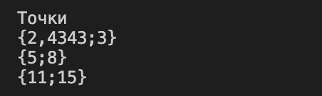
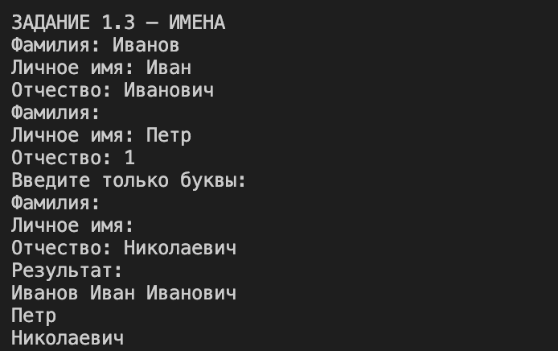
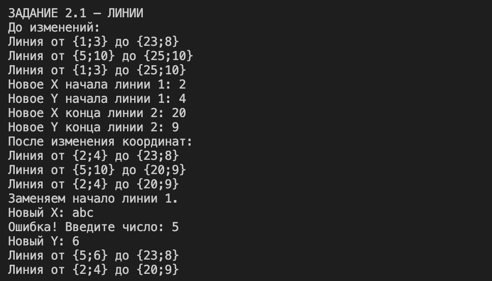
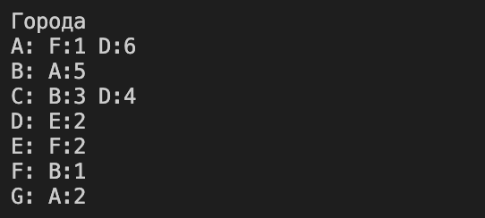
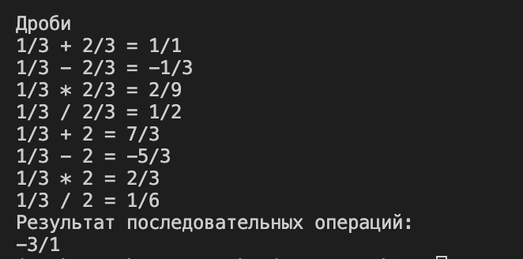
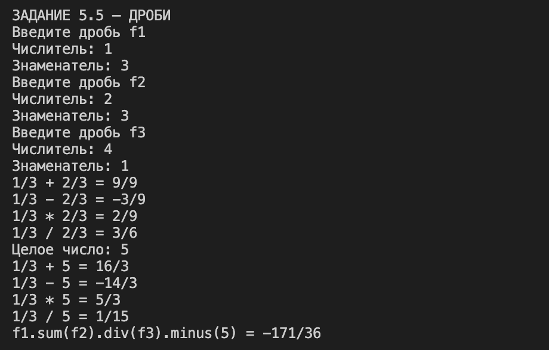

# Казанцев Иван ЛА-2 Лабораторная №2 Вариант 5

# Задание 1

## Задача 1

### Текст задачи

Создать сущность Точка, расположенную на двумерной плоскости, которая описывается двумя координатами X и Y. Точка должна возвращать текстовое представление вида "{X;Y}".

Необходимо создать три точки с разными координатами и вывести на экран их текстовое представление.

### Алгоритм решения

1. Создать класс Point с приватными полями для хранения координат X и Y.
2. Создать свойства X и Y для получения и изменения координат.
3. Создать конструктор, принимающий обе координаты.
4. Переопределить метод ToString() для вывода точки в формате "{X;Y}".
5. Создать три точки с разными координатами.
6. Вывести текстовое представление каждой точки на экран.

### Тестирование

---

## Задача 3

### Текст задачи

Создать сущность Имя, которая описывается тремя параметрами: фамилия, личное имя и отчество.

Имя может быть приведено к строковому виду, включающему традиционное представление всех трёх параметров: Фамилия Имя Отчество.

Необходимо предусмотреть возможность того, что какой-либо из параметров может быть не задан. В этом случае он не учитывается при приведении к текстовому виду.

Необходимо создать следующие имена:
- Клеопатра;
- Пушкин Александр Сергеевич;
- Маяковский Владимир.

### Алгоритм решения

1. Создать класс Name с полями для хранения фамилии, личного имени и отчества.
2. Создать свойства для доступа к частям имени.
3. Реализовать конструкторы с одним, двумя и тремя параметрами.
4. Переопределить метод ToString().
5. Проверять наличие фамилии и отчества перед добавлением их в строку.
6. Создать три заданных имени и вывести их на экран.

### Тестирование

---

# Задание 2

## Задача 1

### Текст задачи

Создать сущность Линия, расположенную на двумерной плоскости, которая описывается координатой начала и координатой конца. Для задания координат необходимо использовать сущность Точка, разработанную в задании 1.1.

Линия должна возвращать текстовое представление вида "Линия от {X1;Y1} до {X2;Y2}".

Необходимо создать линии со следующими характеристиками:

1. Линия 1 с началом в точке {1;3} и концом в точке {23;8}.
2. Линия 2, горизонтальная, на высоте 10, от точки с X = 5 до точки с X = 25.
3. Линия 3, которая начинается там же, где начинается линия 1, и заканчивается там же, где заканчивается линия 2.
4. После создания всех трёх объектов изменить координаты первой и второй линий так, чтобы положение третьей линии соответствовало требованиям пункта 3.
5. Изменить координаты первой линии так, чтобы при этом не изменились координаты третьей линии.

### Алгоритм решения

1. Создать класс Line, содержащий начальную и конечную точки типа Point.
2. Создать конструктор, принимающий начальную и конечную точки.
3. Создать свойства Start и End.
4. Переопределить метод ToString() для вывода линии.
5. Создать три линии, используя общие объекты Point для первой и третьей линий, а также второй и третьей линий.
6. Изменить координаты общих точек и проверить изменение положения линий.
7. Заменить начальную точку первой линии новым объектом Point и проверить, что координаты третьей линии не изменились.

### Тестирование

---

# Задание 3

## Задача 3

### Текст задачи

Создать сущность Город, которая будет представлять собой точку на карте со следующими характеристиками:
- Название города.
- Набор путей к следующим городам, где путь представляет собой сочетание Города и стоимости поездки в него.

Город должен возвращать текстовое представление в виде названия города и списка связанных с ним городов в виде пар "название:стоимость".

Используя разработанную сущность, реализовать схему городов и путей между ними, представленную на рисунке 2 методички.

### Алгоритм решения

1. Создать класс City с полями для названия города, связанных городов и стоимости путей.
2. Создать свойства для доступа к названию города и массивам путей и стоимостей.
3. Реализовать конструктор для создания города с названием.
4. Реализовать метод ToString() для вывода названия города и списка связанных городов с указанием стоимости путей.
5. Создать города A, B, C, D, E и F.
6. Задать направления путей и их стоимость в соответствии со схемой из методички.
7. Вывести информацию о каждом городе на экран.

### Тестирование

---

# Задание 4

## Задача 8

### Текст задачи

Изменить сущность Город из задачи 3.3.

Необходимо предусмотреть два способа создания города:
- Город можно создать, указав только название.
- Город можно создать, указав название, набор связанных с ним городов и стоимости путей к ним.

### Алгоритм решения

1. В классе City реализовать конструктор, принимающий только название города.
2. Реализовать второй конструктор, принимающий название города, массив связанных городов и массив стоимостей путей.
3. В первом конструкторе инициализировать пустые массивы связанных городов и стоимостей.
4. Создать города с использованием обоих конструкторов.
5. Вывести результаты на экран и проверить работу конструкторов.

### Тестирование

---

# Задание 5

## Задача 5

### Текст задачи

Создать сущность Дробь со следующими особенностями:
- Имеет числитель — целое число.
- Имеет знаменатель — целое число.
- Дробь может быть создана с указанием числителя и знаменателя.
- Может вернуть строковое представление вида "числитель/знаменатель".
- Может выполнять операции сложения, вычитания, умножения и деления с другой дробью или целым числом.
- Результатом каждой операции должна быть новая дробь, при этом исходные дроби не изменяются.

Необходимо выполнить следующие задачи:

1. Создать несколько экземпляров дробей.
2. Написать по одному примеру использования каждого метода.
3. Вывести на экран примеры и результаты их выполнения в формате "1/3 * 2/3 = 2/9".
4. Посчитать выражение f1.sum(f2).div(f3).minus(5).

### Алгоритм решения

1. Создать класс Fraction с приватными полями для хранения числителя и знаменателя.
2. Создать свойства Numerator и Denominator.
3. Реализовать конструктор, принимающий числитель и знаменатель.
4. Предусмотреть проверку, чтобы знаменатель не мог быть равен нулю.
5. Реализовать метод ToString() для вывода дроби в формате "числитель/знаменатель".
6. Реализовать методы sum, minus, mult и div для операций с другой дробью и целым числом.
7. Сделать так, чтобы каждая операция возвращала новый объект Fraction, не изменяя исходные дроби.
8. Реализовать сокращение дробей.
9. Вывести примеры всех операций и выполнить указанную цепочку вызовов методов.

### Тестирование

